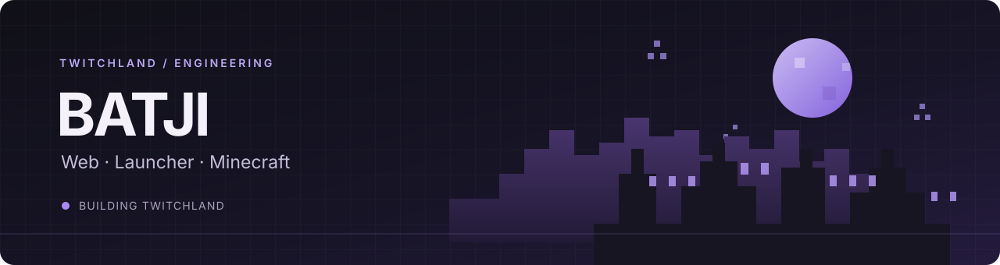

  

<h1 align="center">BATJI</h1>

  Разрабатываю <a href="https://tw1tchland.ru/">TwitchLand</a> — связываю веб-платформу, лаунчер и Minecraft-серверы в один проект.

  <a href="https://tw1tchland.ru/">Сайт TwitchLand</a>
  &nbsp;·&nbsp;
  <a href="https://t.me/playtwitchland">Telegram</a>
  &nbsp;·&nbsp;
  <a href="https://discord.gg/Z52UaNhhAY">Discord</a>

---

## Чем занимаюсь

- Развиваю сайт и API TwitchLand на Laravel.
- Работаю над собственным лаунчером и связью аккаунта с игровыми серверами.
- Настраиваю интеграции Minecraft, включая серверные плагины и Towny.
- Дорабатываю интерфейсы так, чтобы ими было удобно пользоваться в игре и на сайте.

## Технологии

| Направление | Стек |
|:--|:--|
| Backend | PHP · Laravel 12 |
| Web | JavaScript · Blade · HTML · CSS |
| Launcher | C# · .NET |
| Minecraft | Java · Purpur · Towny API |
| Данные | SQL |

## Сейчас в работе

### TwitchLand

Веб-платформа и инструменты для Minecraft-проекта: аккаунты, лаунчер, серверные интеграции и игровые функции.

**[Открыть TwitchLand →](https://tw1tchland.ru/)**

---

BATJI · TwitchLand · Web / Launcher / Minecraft

