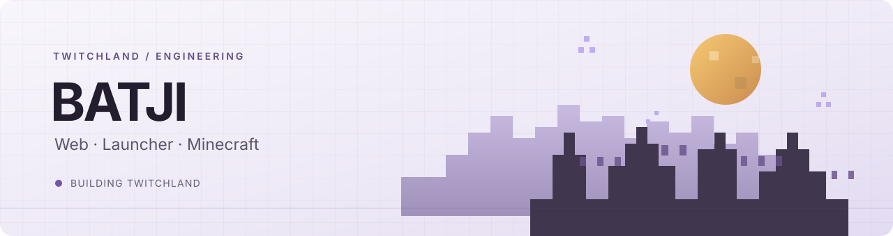
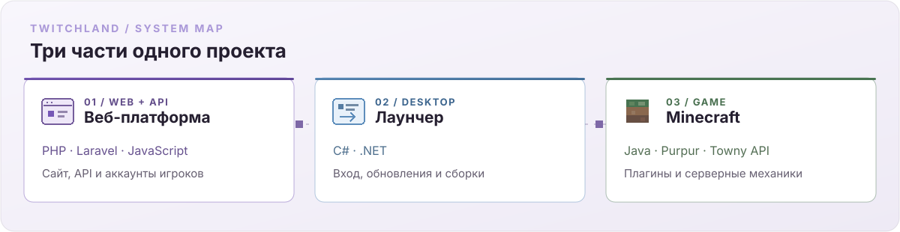

  <picture>
    <source media="(prefers-color-scheme: dark)" srcset="assets/profile-banner.svg">
    <source media="(prefers-color-scheme: light)" srcset="assets/profile-banner-light.svg">
    
  </picture>

<h1 align="center">Привет, я BATJI</h1>

  Развиваю <a href="https://tw1tchland.ru/">TwitchLand</a> — игровой проект, где сайт, лаунчер и Minecraft-сервер работают вместе.

  <a href="https://tw1tchland.ru/">Сайт TwitchLand</a>
  &nbsp;·&nbsp;
  <a href="https://t.me/playtwitchland">Telegram</a>
  &nbsp;·&nbsp;
  <a href="https://discord.gg/Z52UaNhhAY">Discord</a>

---

  <picture>
    <source media="(prefers-color-scheme: dark)" srcset="assets/twitchland-system.svg">
    <source media="(prefers-color-scheme: light)" srcset="assets/twitchland-system-light.svg">
    
  </picture>

## Над чем работаю

Стараюсь, чтобы путь игрока не распадался на отдельные сервисы: аккаунт на сайте, вход через лаунчер и игровые функции должны согласованно работать на сервере.

## Технологии

| WEB / API | LAUNCHER | MINECRAFT |
|:--|:--|:--|
| `PHP` · `Laravel 12` · `JavaScript` · `Blade` · `HTML` · `CSS` · `SQL` | `C#` · `.NET` | `Java` · `Purpur` · `Towny API` |

## Проект

### TwitchLand

Сайт, лаунчер и набор игровых интеграций для Minecraft-сообщества.

  <a href="https://tw1tchland.ru/">Сайт проекта</a>
  &nbsp;·&nbsp;
  <a href="https://t.me/playtwitchland">Сообщество в Telegram</a>
  &nbsp;·&nbsp;
  <a href="https://discord.gg/Z52UaNhhAY">Discord</a>

---

BATJI · TwitchLand · Web / Launcher / Minecraft

